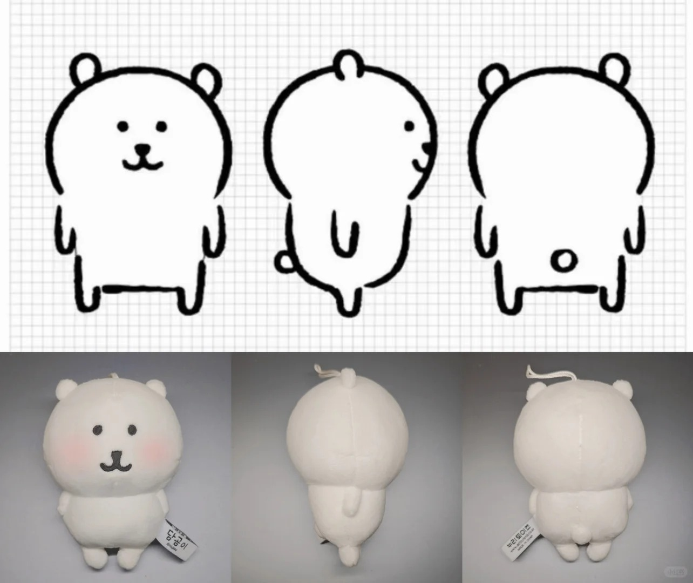
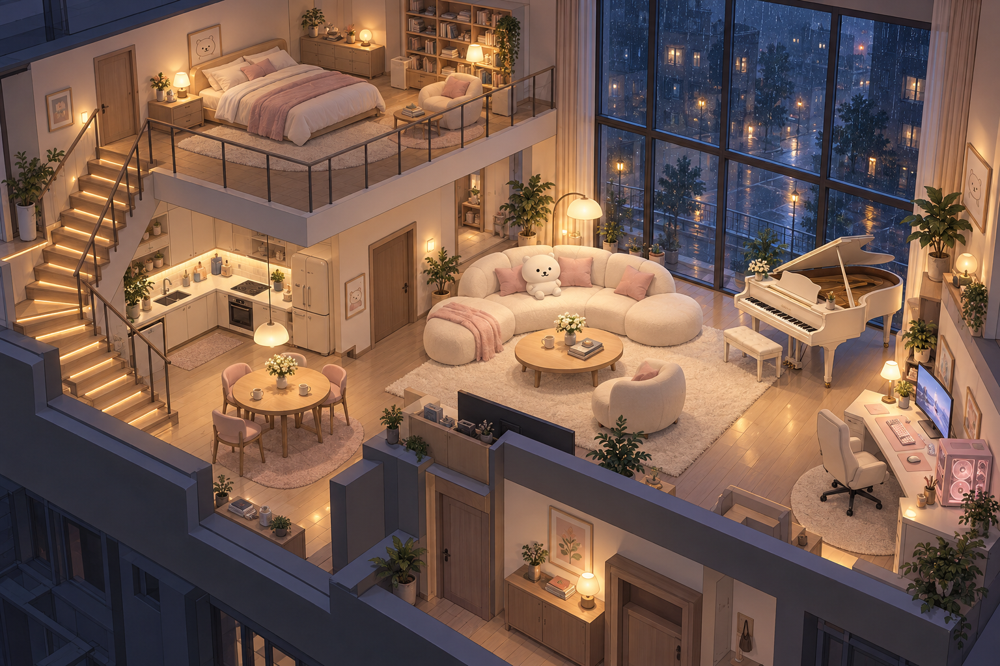
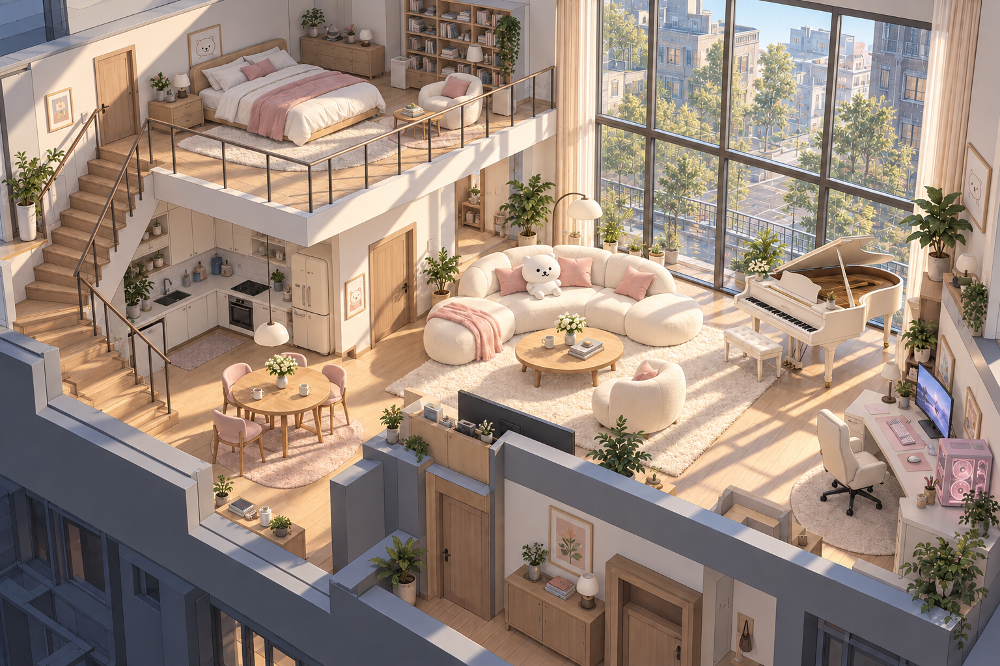
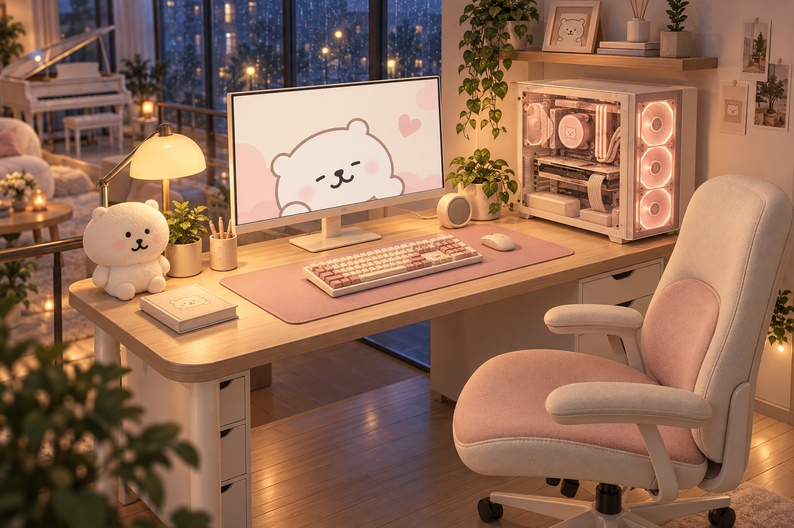

# 萌系 Loft 美术参考说明

本文件规定参考图片对场景的约束范围，与[场景需求](requirements.md)及[精细度与验收标准](quality-standards.md)共同使用。新增图片是 AI 生成的美术概念参考，不是 Blender 成果、Three.js 运行截图或在线验收证据。

当前美术方向为**萌系偏写实**。用户认可首张雨夜图的写实质感，后续图片与实现以此为准：保留圆润软萌的形体、精细模型、细腻布料和自然灯光。早期“三渲二卡通渲染、明显轮廓描边”不再属于硬性约束，也不需要把这组参考图重新处理成漫画色块。

## 参考资料的优先关系

- 用户原始玩偶图决定玩偶的圆润比例、耳朵与短肢、简洁五官、绒面和缝线特征。
- 文字需求决定 125㎡面积、上下层分区、通道、家具配置、88 键结构、触控行为与交付要求。
- 生成概念图表达整体配色、灯光主次、材质层次及局部细节的目标。图片出现结构不合理、布局偏差或物件遗漏时，以文字要求补正，不能据此删减需求。

图片里的摆件密度、品牌字样、琴键数、楼梯踏步数和电脑内部拓扑不属于精确依据。图片没有展示的区域仍需满足完整模型、可观察和正常运行的要求。多视角浏览不能退化为只在概念图角度好看的舞台布景。

## 用户提供的玩偶图

| 文件 | 主要用途 | 建模时应保留的特征 |
| --- | --- | --- |
| [1.jpg](1.jpg) | 正、侧、背面形体 | 饱满圆头、短身、侧面头身体积差、小耳与短肢、背部缝线和小尾部 |
| [2.jpg](2.jpg) | 正面比例及近景表面 | 奶白绒面、黑色刺绣感五官、头身连接、自然缝合与少量腮红 |
| [3.jpg](3.jpg) | 表情与软萌气质 | 普通点眼与困倦表情、圆润轮廓、柔软体积；允许在主题壁纸中扩展表情 |

主玩偶采用普通点眼表情，困倦表情可用于另一只摆件或壁纸。实物照片中的手、吊绳、标签文字和背景不要求复制。室内玩偶按约 35 厘米高设计，放在沙发上便于近景观察；桌面小摆件可使用同主题约 12 厘米的简化变体，不能替代主玩偶。

## 整体雨夜参考

[查看原图](references/loft-night-v1.png)

采用温暖灯光中的奶白家具、克制的粉色点缀、浅木色地板，以及窗外冷蓝雨夜的对比。可借鉴分区亮度、主体与背景的分离、窗外湿润反光和安静的日常气氛。

灯光应通过照亮地板、软包、台面和墙面表现作用范围。主视觉落在客厅玩偶与钢琴，电脑角和上层卧室有可辨识的局部亮度；不能用全屋均匀橙色或一圈发光灯带代替照明设计。室内地板保持木地板观感，湿润反光重点属于窗外街景与玻璃。

图中的夹层覆盖、楼梯走向和局部家具位置是概念表达，不用来重新定义平面布局。最终仍采用文字中“下层 80㎡、南侧夹层 45㎡、北侧挑空及楼梯开口 35㎡”的面积关系，琴键数量按 88 键建模。图中可能未出现的循环扇、净化设备等陈设，按质量规范中的完整家具清单配置。

## 整体白天参考

[查看原图](references/loft-day-v1.png)

白天参考与夜景采用同一空间作为配对目标，重点比较日照方向、窗框投影、白色家具的明暗和夹层下方的可读性。最终模型昼夜切换时，家具、户型和镜头必须保持一致；生成图可能产生的细部漂移不属于允许的运行行为。

阳光应形成有方向的明亮区域，照亮地板并落到部分家具上。日间灯具退居次要位置，保留白色材质的阴影和粉色层次，避免整屋过曝或只把夜景统一调亮。

## 电脑桌近景参考

[查看原图](references/computer-corner-v1.png)

采用奶白外壳、浅木桌面、少量粉色键帽与软包、克制的暖色机箱灯。重点观察机箱面板厚度、玻璃边缘、风扇叶片、内部前后层次，显示器边框与支架，独立键帽、桌垫包边和座椅缝线。微小螺丝与电路文字并非重点。

屏幕熊图表达主题和构图方向，实际轮播素材仍需另行生成并作为独立图片贴图交付。主机必须在运行时看得到旋转风扇，椅子慢速左右摆动；静态参考图本身不能证明这些要求已经满足。

## 配色、材质与画面控制

| 部分 | 设计约束 |
| --- | --- |
| 主色 | 奶白、暖米白与浅木色占据主要画面；白色物体仍有清楚的受光面、背光面和轮廓 |
| 点缀 | 淡粉集中用于靠垫、桌垫、少量键帽和画作；避免整屋高饱和粉色及彩虹灯效 |
| 轮廓 | 通过造型、明暗和材质区分物体，结构转折清楚；可选的细描边不能遮没五官、琴键间隙和接缝 |
| 绒面与布料 | 柔和、低反光，少量细纹表现材质；不依赖高密度毛发或布满噪点的纹理 |
| 木材 | 浅色、细木纹与柔和反光，拼接和厚度可辨；不使用强烈写实裂纹抢夺注意力 |
| 硬质外壳 | 钢琴与电脑边缘有真实厚度和倒角，高光克制，避免所有表面像同一种塑料 |
| 玻璃与金属 | 玻璃有边缘与局部反射，机箱内部仍清楚；金属用少量结构性亮点表达 |
| 生活感 | 书、杯子、软毯和主题画适量出现，集中形成小组，主要通路和桌面保留留白 |

画面需要具备细腻的三维结构、自然的明暗过渡和柔软但有层次的材质。概念图采用偏写实的精致室内表现；最终手机场景可以简化高成本渲染效果，但应保留相近的材质区分和灯光气氛。镜头观察以重点物件清晰为准，不强制浅景深，不能用模糊遮盖细节。

## 素材来源与记录

`1.jpg`、`2.jpg`、`3.jpg` 为用户提供的原始资料，保留原文件。`references/` 中的概念图使用内置 imagegen 生成；完整提示词、输入参考与生成用途见[生成记录](references/generation-prompts.md)。生成图只是本项目的设计参考，不能替代相框、电视和显示器各自要求的运行贴图，也不能替代可编辑的 Blender 资产。
